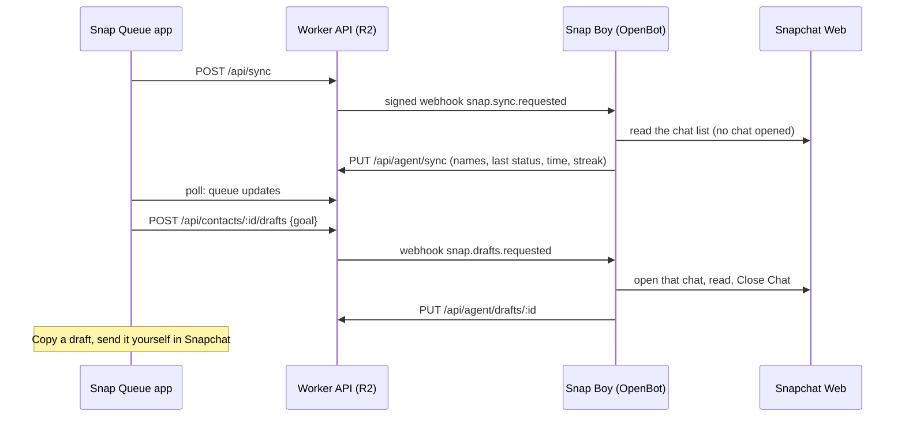

# Snap Queue

Every Snapchat chat in one queue, sorted by whose move it is, with each contact's status. **Snap Boy** (an OpenBot agent) links it to Snapchat: press **Sync** and it reads your Snapchat Web chat list; press **Get drafts** on a contact and it reads that one chat and drafts 2 or 3 replies. You copy one and send it yourself in Snapchat.

- **App:** https://thl007.github.io/snap-queue/ (Expo web PWA; add it to your home screen). Example data: https://thl007.github.io/snap-queue/?demo=1
- **API:** https://snap-queue-api.thl007.workers.dev (Cloudflare Worker, R2 bucket `snap-queue`)
- **Agent:** Snap Boy, through the OpenBot webhook routine "Snap Queue: sync chats and draft replies"
- **Android / iOS:** the same screen as an Expo DOM component inside a native WebView (`npx expo start`, then Expo Go or `eas build`)

## Flow



Snapchat has no API for personal chats, so there is no direct Snapchat webhook: the agent is the link. Nothing in this project sends a message.

## Lanes and statuses

- **Lanes** (computed): *Your move* (they sent last or unread), *Waiting on them* (you sent last), *Plans* (number, date planned, date done), *Parked* (paused, stopped), *All*.
- **Stage** (you set it, sync moves `opened` to `replied` when they answer): new, opened, replied, rapport, number, date planned, date done, paused, stopped. Stopped = clear disinterest: no drafts.
- **Chat state** (from sync): who sent last, chat or snap, the label Snapchat shows (New Chat, Received, Opened, Delivered...), time, streak.

Stored per contact: display name, those statuses, your next step and notes, the last drafts and a short history. No message text is stored, only Snap Boy's drafts and a one-line read of the other person's energy.

## API

`Authorization: Bearer <token>` on every `/api` route except `/api/status`.

| Route | Who | |
|--|--|--|
| `GET /api/status` | anyone | `{appTokenSet, webhook, agent}` |
| `POST /api/setup` | first run, then user | `{appToken?, webhookSecret?}` |
| `GET /api/contacts` | user, agent | `{contacts, sync}` |
| `POST /api/contacts` | user | `{name, stage}` |
| `PATCH /api/contacts/:id` | user | `{stage?, note?, nextStep?, pinned?, name?}` |
| `DELETE /api/contacts/:id`, `POST /api/contacts/restore` | user | remove, undo |
| `POST /api/sync` | user | fires `snap.sync.requested` |
| `POST /api/contacts/:id/drafts` | user | `{goal}`, fires `snap.drafts.requested` |
| `PUT /api/agent/sync` | agent | `{contacts:[{name, unread, streak, chat:{who, kind, state, label, ago}}]}` or `{ok:false, error}` |
| `PUT /api/agent/drafts/:id` | agent | `{read, drafts:[{text, angle, pick}], chat?}` or `{ok:false, error}` |
| `POST /api/agent/claim` | once | sets the agent token; closed after |

Webhooks are signed like OpenBot expects: `x-openbot-signature: sha256=HMAC(secret, "<ts>.<delivery>.<body>")`.

## Snap Boy side

`node worker/agent.mjs sync <file.json> | drafts <id> <file.json> | fail-sync "<reason>" | fail-drafts <id> "<reason>" | list` (reads `worker/.env`: `SQ_API`, `SQ_AGENT_TOKEN`, never committed).

## Develop

```bash
npm install
npm run web        # dev server
npm run build      # static web export to dist/
npm run deploy     # build and publish dist/ to gh-pages
npx expo start     # Android / iOS via Expo Go
```

The Worker deploys with `wrangler deploy` from `worker/` (or the Cloudflare API).

## Design

Hallmark, theme **Hum** (dealt 3/3): grained cream paper, card-stock buttons that press down, Chillax throughout, pear for the primary action, coral for new chats, sugar blue for sent, mint for opened. Tokens in `src/styles/tokens.css`; the stamp and waivers at the top of `src/styles/app.css`.
